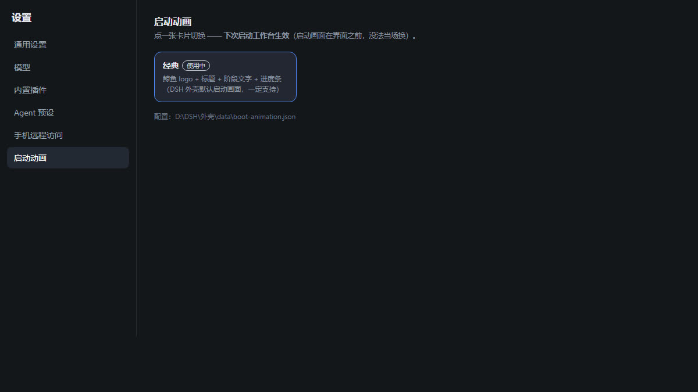

# 启动动画选择器（插件）

给 DSH 的设置页加一个「**启动动画**」分区：点卡片换工作台的启动画面，**下次启动生效**。

## 装完你会看到

```
设置 → 启动动画
┌──────────────────────────────┐
│ 经典  [使用中]                │
│ 鲸鱼 logo + 标题 + 阶段文字 + 进度条 │
└──────────────────────────────┘
配置：<DSH 根>\外壳\data\boot-animation.json
```



当前**只上线「经典」**一个。别的动画（片头视频、主题版）还在整理，做好一个加一个。

## 它到底做了什么（先看这段，不然会误会）

DSH 的启动画面是**外壳**（Electron 工作台）画的，在引擎页面加载之前。
所以这个插件**不负责播放**，它只做两件事：

1. 在设置里给你一个选择界面（`settings.section` 插槽）
2. 把你选的 id 写进契约文件 `外壳\data\boot-animation.json`

⇒ **外壳管播，插件管选**。这也是为什么「换完要下次启动才生效」：画面在界面之前，没法当场换。

## 安装

1. 把 `src/` 整个复制到 `引擎\插件\boot-anim\`
2. 打开 `引擎\.dsh\profiles\web\cordis.patch.yml`，在你自己的插件段里加两行：

   ```yaml
   - id: boot-anim-host
     name: dsh-plugin-boot-anim
   ```

3. 重启引擎（或等 profile 热加载），进 **设置 → 启动动画**

> 外壳目录默认从 `DSH_HOME` 反推（`<DSH 根>\外壳`）；不在这个结构里的，启动前设 `DSH_SHELL_DIR` 指过去。

## 目录

```
src/
├─ package.json     插件清单（dsh.client 声明注入 settings 插槽）
├─ catalog.json     ★ 已上线动画清单（现在只有 classic）
├─ lib/index.js     主机侧：GET /plugins/boot-anim/list · POST /select
└─ client/client.js 设置页 UI（React，走 slots 注入）
```

## 加一个动画（以后）

1. 在外壳里把动画实现好（外壳负责播放，认 `boot-animation.json` 的 `id`）
2. 在 `catalog.json` 的 `items` 里加一条 `{ id, name, desc }`
3. 改 `version`，跑一遍仓库的 `node tools/validate-item.mjs`

插件**不会**覆盖外壳写出的 `available` 清单——只改 `id`，避免把别人本地的动画冲掉。

## 坑

| 现象 | 原因 |
|---|---|
| 卡片点了没反应 | 你的外壳版本不支持 `boot-animation.json` 这个契约；「经典」是外壳内置的，一般没问题 |
| 换了但启动还是老画面 | 正常，**下次启动**才生效；点选后外壳会立刻预览一次（`boot-preview.json` 通道） |
| 配置写到了别处 | 外壳不在默认路径 → 设 `DSH_SHELL_DIR` |
| 设置里没有「启动动画」 | 插件没被加载：查 `cordis.patch.yml` 有没有 `boot-anim-host`，或看引擎启动日志 |
